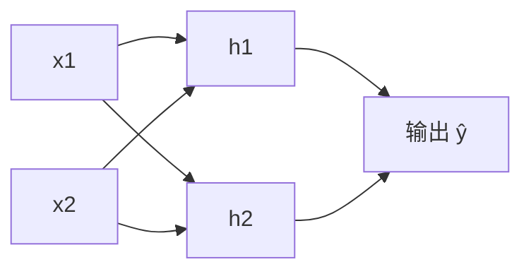

# 第 8 章：把神经元摞起来

- **难度**：★★☆ | **预估学时**：1.2 小时 | **前置**：第 6、7 章

## 学习目标

学完本章，你能：

1. 画出 2-2-1 网络的结构，数清它的参数；
2. 按层算出前向传播的每一个中间值；
3. 解释隐藏层在做什么，以及为什么叫"隐藏"。

## 一句话核心

前向传播就是按层做"矩阵乘 + 加偏置 + 过激活"，一层一层往前推，直到算出输出。

## 零基础讲解

### 网络结构

要算的网络长这样：2 个输入，2 个隐藏神经元，1 个输出。

看图说明：左边两个输入，中间两个隐藏神经元，右边一个输出。每根箭头代表一个权重。这个网络共有 $2\times 2+2\times 1=6$ 个权重，加上 2 个隐藏偏置和 1 个输出偏置，一共 9 个参数。

### 规定好符号

输入：

$$
x_1=1.0,\qquad x_2=0.5
$$

隐藏层权重与偏置：

$$
w_{11}=0.5,\ w_{12}=-0.3,\ b_1=0.1
$$

$$
w_{21}=0.2,\ w_{22}=0.8,\ b_2=-0.2
$$

输出层权重与偏置：

$$
v_1=0.6,\ v_2=-0.4,\ b_o=0.2
$$

$w_{ij}$ 的第一个下标是隐藏神经元编号，第二个是输入编号。$v_i$ 是输出神经元连到第 $i$ 个隐藏神经元的权重。

激活函数统一用 sigmoid。

### 第一层：算两个隐藏值

第一个隐藏神经元：

$$
z_1=w_{11}x_1+w_{12}x_2+b_1=0.5\times 1.0+(-0.3)\times 0.5+0.1
$$

$$
z_1=0.5-0.15+0.1=0.45
$$

$$
h_1=\sigma(0.45)=\frac{1}{1+e^{-0.45}}=\frac{1}{1+0.637628}=0.610639
$$

第二个隐藏神经元：

$$
z_2=w_{21}x_1+w_{22}x_2+b_2=0.2\times 1.0+0.8\times 0.5-0.2
$$

$$
z_2=0.2+0.4-0.2=0.4
$$

$$
h_2=\sigma(0.4)=\frac{1}{1+e^{-0.4}}=\frac{1}{1+0.670320}=0.598688
$$

两个隐藏值都算出来了：$h_1=0.610639$，$h_2=0.598688$。

### 第二层：算输出

$$
z_o=v_1h_1+v_2h_2+b_o=0.6\times 0.610639+(-0.4)\times 0.598688+0.2
$$

分项算：

$$
0.6\times 0.610639=0.366383
$$

$$
-0.4\times 0.598688=-0.239475
$$

$$
z_o=0.366383-0.239475+0.2=0.326908
$$

再过一次 sigmoid：

$$
\hat{y}=\sigma(0.326908)=\frac{1}{1+e^{-0.326908}}=\frac{1}{1+0.721112}=0.581007
$$

网络对输入 $(1.0,0.5)$ 的预测是 0.581。如果真实标签是 1，这个预测偏低了一点；如果真实标签是 0，又偏高。第 9 章会用这个差距定义损失。

### 一张表看全过程

| 步骤 | 计算 | 结果 |
|---|---|---|
| 隐藏层打分 1 | $0.5\times 1.0-0.3\times 0.5+0.1$ | 0.4500 |
| 隐藏层激活 1 | $\sigma(0.45)$ | 0.610639 |
| 隐藏层打分 2 | $0.2\times 1.0+0.8\times 0.5-0.2$ | 0.4000 |
| 隐藏层激活 2 | $\sigma(0.4)$ | 0.598688 |
| 输出层打分 | $0.6h_1-0.4h_2+0.2$ | 0.326908 |
| 输出层激活 | $\sigma(0.326908)$ | 0.581007 |

### 用矩阵写一遍

同样的计算，用第 5 章的写法：

$$
\mathbf{W}=\begin{bmatrix}0.5&-0.3\\0.2&0.8\end{bmatrix},\quad
\mathbf{b}=\begin{bmatrix}0.1\\-0.2\end{bmatrix},\quad
\mathbf{x}=\begin{bmatrix}1.0\\0.5\end{bmatrix}
$$

$$
\mathbf{z}=\mathbf{W}\mathbf{x}+\mathbf{b}=\begin{bmatrix}0.45\\0.4\end{bmatrix}
$$

$$
\mathbf{h}=\sigma(\mathbf{z})=\begin{bmatrix}0.610639\\0.598688\end{bmatrix}
$$

输出层：

$$
\mathbf{v}=\begin{bmatrix}0.6&-0.4\end{bmatrix},\qquad z_o=\mathbf{v}\mathbf{h}+0.2=0.326908
$$

矩阵写法把"逐个神经元循环"变成了"一次乘加"。层数多、神经元多时，这个差别决定了能不能在合理时间内算完。

### 隐藏层在做什么

"隐藏"这个名字来自历史：训练数据里能看到输入和输出，中间层的值没有标签告诉我们对不对，它们是网络自己算出来的中间表示，从外面看不见。

它做的不是"把输入抄一遍"。每个隐藏神经元对输入做一次加权组合，再过非线性，得到一个新的数。两个隐藏神经元就得到两个新数，相当于把原来 2 维的输入换了一套坐标。输出层在这套新坐标上再做一次线性组合。

可以把它理解成"网络自己学出来的一组特征"。手写数字识别里，靠前的隐藏层可能对边缘敏感，靠后的可能对笔画组合敏感。但这是训练后观察到的现象，不是设计时写死的规则。多数情况下，单个隐藏神经元的含义很难用一句话说清。

## 类比与实例

**类比**：一条流水线。第一组工人把原料按不同配方混合，产出两种半成品；第二组工人把半成品再按配方混合，产出成品。每个工人只做"按配方称量混合"这一件事，配方（权重）决定最终产品。

类比失效的地方：流水线的配方是人定的，网络里的配方是训练出来的；流水线工人不会互相影响，隐藏层的输出会同时喂给下一层所有神经元。

**实例**：换一组输入 $x_1=0,\ x_2=1$，同样用上面的参数。

$z_1=0+(-0.3)\times 1+0.1=-0.2$，$h_1=\sigma(-0.2)=0.450166$。
$z_2=0+0.8\times 1-0.2=0.6$，$h_2=\sigma(0.6)=0.645656$。
$z_o=0.6\times 0.450166-0.4\times 0.645656+0.2=0.270100-0.258262+0.2=0.211838$。
$\hat{y}=\sigma(0.211838)=0.552748$。

同一个小网络，换个输入，输出从 0.581 变成 0.553。变化不大，因为权重还是随机的、没训练过的样子。训练就是要把这些权重调到"该大就大、该小就小"。

## 常见误解

**别以为隐藏层越多参数一定越多**——参数由每层的宽度决定。一个很宽的单隐藏层可能比一个很窄的多层网络参数更多。深度和宽度是两条不同的路。

**别以为隐藏层的每个神经元一定对应一个可解释的概念**——有些网络确实能观察到"边缘检测器""眼睛检测器"，但这是事后分析，不是保证。大多数隐藏单元是分布式表示，一个概念分散在多个神经元上，一个神经元也参与多个概念。

## 自测题（答案）

1. 上面这个 2-2-1 网络一共有多少个可训练参数？

   **答案**：9 个。隐藏层 $2\times 2=4$ 个权重加 2 个偏置，输出层 2 个权重加 1 个偏置。

   **解析**：参数 = 权重 + 偏置。输入和隐藏层之间的每条连线是一个权重，共 4 条；隐藏层到输出共 2 条；偏置每个神经元一个，共 3 个。

2. 若把 $b_1$ 从 0.1 改成 0.6，其他不变，$h_1$ 变成多少？

   **答案**：$z_1=0.5-0.15+0.6=0.95$，$h_1=\sigma(0.95)=0.721115$。

   **解析**：偏置只加在打分上。$e^{-0.95}=0.386741$，$1/(1+0.386741)=0.721115$。

## 复习锚点

- 前向传播 = 逐层"矩阵乘 + 偏置 + 激活"。
- 2-2-1 网络 9 个参数，算完得到 $\hat{y}=0.581007$。
- 隐藏层把输入换到一套新坐标，这套坐标是训练学出来的。
