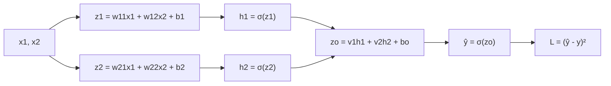

# 第 11 章：误差怎么传回去

- **难度**：★★★ | **预估学时**：2 小时 | **前置**：第 4、7、8、9、10 章

## 学习目标

学完本章，你能：

1. 说清反向传播要解决什么问题，以及为什么不能逐个参数试；
2. 用链式法则推出输出层和隐藏层的误差项 $\delta$；
3. 手算 2-2-1 网络一次完整的反向传播，得到全部 9 个梯度。

## 一句话核心

反向传播就是链式法则在网络上跑一遍，从损失出发，把误差一层层往回乘。

## 零基础讲解

### 问题：9 个参数，怎么求 9 个导数

第 8 章的网络有 9 个参数。要训练它，需要知道损失对每个参数的偏导。

最笨的办法：把 $w_{11}$ 改一点点，重新算一遍损失，看变化多少；再改 $w_{12}$，再算一遍……9 个参数要算 9 次前向。真实网络有几百万个参数，这个办法要算几百万次前向，完全不可行。

反向传播的做法：**一次前向算出损失，再一次反向算出全部 9 个梯度。**

### 先看计算图

把前向传播拆成一个个小步骤，每一步只做一件事：

看图说明：数据从左往右流，每一步的输出是下一步的输入。反向传播时，从最右边的 $L$ 出发，沿着箭头反方向走，每遇到一个节点就用链式法则乘上这个节点自己的导数。

### 定义误差项 δ

记 $\delta_j=\dfrac{\partial L}{\partial z_j}$，意思是"第 $j$ 个神经元在激活之前的打分 $z_j$ 变化一点点，损失跟着变多少"。

为什么盯住 $z$ 而不是盯住输出 $h$？因为每个参数的梯度都能写成"$\delta$ 乘以这个参数的输入"。盯住 $z$，参数的梯度就只差一个乘数。

### 输出层：先算 δ_o

输出层的计算链是：

$$
z_o \xrightarrow{\sigma} \hat{y}\xrightarrow{\text{平方误差}} L
$$

按链式法则：

$$
\delta_o=\frac{\partial L}{\partial z_o}
=\frac{\partial L}{\partial \hat{y}}\cdot\frac{\partial \hat{y}}{\partial z_o}
$$

第一项，$L=(\hat{y}-y)^2$ 对 $\hat{y}$ 求导：

$$
\frac{\partial L}{\partial \hat{y}}=2(\hat{y}-y)
$$

第二项，$\hat{y}=\sigma(z_o)$ 对 $z_o$ 求导，就是第 7 章推过的 $\sigma(1-\sigma)$：

$$
\frac{\partial \hat{y}}{\partial z_o}=\hat{y}(1-\hat{y})
$$

代进去：

$$
\delta_o=2(\hat{y}-y)\cdot\hat{y}(1-\hat{y})
$$

代入数值：$\hat{y}=0.581007$，$y=1$。

$$
2(0.581007-1)=2\times(-0.418993)=-0.837986
$$

$$
\hat{y}(1-\hat{y})=0.581007\times 0.418993=0.243438
$$

$$
\delta_o=-0.837986\times 0.243438=-0.203998
$$

### 输出层参数的梯度

$z_o=v_1h_1+v_2h_2+b_o$。对 $v_1$ 求偏导，$v_1$ 只出现在 $v_1h_1$ 这一项，导数是 $h_1$：

$$
\frac{\partial L}{\partial v_1}=\frac{\partial L}{\partial z_o}\cdot\frac{\partial z_o}{\partial v_1}=\delta_o\cdot h_1
$$

$$
\delta_o h_1=-0.203998\times 0.610639=-0.124569
$$

同理：

$$
\frac{\partial L}{\partial v_2}=\delta_o h_2=-0.203998\times 0.598688=-0.122131
$$

$$
\frac{\partial L}{\partial b_o}=\delta_o\cdot 1=-0.203998
$$

### 隐藏层：误差往回传

隐藏层的 $h_1$ 同时影响 $z_o$，进而影响 $L$。还是链式：

$$
\delta_1=\frac{\partial L}{\partial z_1}
=\frac{\partial L}{\partial h_1}\cdot\frac{\partial h_1}{\partial z_1}
$$

先算第一项。$z_o=v_1h_1+v_2h_2+b_o$，$h_1$ 的系数是 $v_1$，所以：

$$
\frac{\partial L}{\partial h_1}=\delta_o\cdot v_1
$$

第二项是 sigmoid 的导数：

$$
\frac{\partial h_1}{\partial z_1}=h_1(1-h_1)
$$

合起来：

$$
\delta_1=\delta_o\cdot v_1\cdot h_1(1-h_1)
$$

代入：

$$
\delta_1=-0.203998\times 0.6\times 0.610639\times 0.389361
$$

$$
0.610639\times 0.389361=0.237759
$$

$$
\delta_1=-0.203998\times 0.6\times 0.237759=-0.029101
$$

同理第二个隐藏神经元：

$$
\delta_2=\delta_o\cdot v_2\cdot h_2(1-h_2)
$$

$$
\delta_2=-0.203998\times(-0.4)\times 0.598688\times 0.401312
$$

$$
0.598688\times 0.401312=0.240261
$$

$$
\delta_2=0.081599\times 0.240261=0.019605
$$

注意 $v_2=-0.4$ 带负号，两个负数相乘得正，所以 $\delta_2$ 是正的。符号不能丢。

### 隐藏层参数的梯度

$z_1=w_{11}x_1+w_{12}x_2+b_1$。对 $w_{11}$ 求偏导得 $x_1$：

$$
\frac{\partial L}{\partial w_{11}}=\delta_1 x_1=-0.029101\times 1.0=-0.029101
$$

$$
\frac{\partial L}{\partial w_{12}}=\delta_1 x_2=-0.029101\times 0.5=-0.014551
$$

$$
\frac{\partial L}{\partial b_1}=\delta_1=-0.029101
$$

同样：

$$
\frac{\partial L}{\partial w_{21}}=\delta_2 x_1=0.019605\times 1.0=0.019605
$$

$$
\frac{\partial L}{\partial w_{22}}=\delta_2 x_2=0.019605\times 0.5=0.009803
$$

$$
\frac{\partial L}{\partial b_2}=\delta_2=0.019605
$$

### 九个梯度汇总

| 参数 | 梯度 | 参数 | 梯度 |
|---|---|---|---|
| $v_1$ | $-0.124569$ | $w_{11}$ | $-0.029101$ |
| $v_2$ | $-0.122131$ | $w_{12}$ | $-0.014551$ |
| $b_o$ | $-0.203998$ | $b_1$ | $-0.029101$ |
| $w_{21}$ | $0.019605$ | $w_{22}$ | $0.009803$ |
| $b_2$ | $0.019605$ | | |

一次前向、一次反向，全部拿到。

### 更新参数

用第 10 章的规则，学习率 $\eta=0.5$：

$$
\theta_{\text{new}}=\theta_{\text{old}}-\eta\frac{\partial L}{\partial \theta}
$$

| 参数 | 旧值 | 梯度 | 新值 |
|---|---|---|---|
| $v_1$ | 0.600 | $-0.124569$ | 0.662284 |
| $v_2$ | $-0.400$ | $-0.122131$ | $-0.338935$ |
| $b_o$ | 0.200 | $-0.203998$ | 0.301999 |
| $w_{11}$ | 0.500 | $-0.029101$ | 0.514551 |
| $w_{12}$ | $-0.300$ | $-0.014551$ | $-0.292725$ |
| $b_1$ | 0.100 | $-0.029101$ | 0.114551 |
| $w_{21}$ | 0.200 | $0.019605$ | 0.190197 |
| $w_{22}$ | 0.800 | $0.009803$ | 0.795099 |
| $b_2$ | $-0.200$ | $0.019605$ | $-0.209803$ |

注意更新方向：梯度为负的参数，新值比旧值**大**（减负数等于加）；梯度为正的参数，新值比旧值**小**。

### 验证：损失真的降了吗

用新参数重新前向一次：

$$
z_1=0.514551\times 1.0+(-0.292725)\times 0.5+0.114551=0.514551-0.146363+0.114551=0.482739
$$

$$
h_1=\sigma(0.482739)=0.618394
$$

$$
z_2=0.190197\times 1.0+0.795099\times 0.5-0.209803=0.190197+0.397550-0.209803=0.377944
$$

$$
h_2=\sigma(0.377944)=0.593377
$$

$$
z_o=0.662284\times 0.618394+(-0.338935)\times 0.593377+0.301999
$$

$$
z_o=0.409560-0.201137+0.301999=0.510422
$$

$$
\hat{y}=\sigma(0.510422)=0.624909
$$

$$
L=(1-0.624909)^2=0.375091^2=0.140693
$$

从 $0.175555$ 降到 $0.140693$。一次更新，损失降了约 20%。方向和步长都对了。

这就是训练的全部循环：前向算损失，反向算梯度，更新参数，重复。

<svg viewBox="0 0 460 200" width="100%" role="img" aria-label="前向与反向两条路径">
<rect x="20" y="70" width="70" height="50" rx="6" fill="none" stroke="#16a34a" stroke-width="2"/>
<text x="40" y="100" font-size="13" fill="#16a34a">输入</text>
<rect x="130" y="70" width="70" height="50" rx="6" fill="none" stroke="#3b82f6" stroke-width="2"/>
<text x="146" y="100" font-size="13" fill="#3b82f6">隐藏</text>
<rect x="240" y="70" width="70" height="50" rx="6" fill="none" stroke="#3b82f6" stroke-width="2"/>
<text x="256" y="100" font-size="13" fill="#3b82f6">输出</text>
<rect x="350" y="70" width="80" height="50" rx="6" fill="none" stroke="#dc2626" stroke-width="2"/>
<text x="368" y="100" font-size="13" fill="#dc2626">损失</text>
<line x1="90" y1="85" x2="125" y2="85" stroke="#16a34a" stroke-width="2"/>
<line x1="200" y1="85" x2="235" y2="85" stroke="#16a34a" stroke-width="2"/>
<line x1="310" y1="85" x2="345" y2="85" stroke="#16a34a" stroke-width="2"/>
<text x="100" y="60" font-size="11" fill="#16a34a">前向</text>
<line x1="350" y1="112" x2="315" y2="112" stroke="#dc2626" stroke-width="2" stroke-dasharray="4 3"/>
<line x1="240" y1="112" x2="205" y2="112" stroke="#dc2626" stroke-width="2" stroke-dasharray="4 3"/>
<line x1="130" y1="112" x2="95" y2="112" stroke="#dc2626" stroke-width="2" stroke-dasharray="4 3"/>
<text x="210" y="140" font-size="11" fill="#dc2626">反向（传梯度）</text>
</svg>

看图说明：实线是从左到右的前向，虚线是从右到左的反向。反向不重新算前向的量，而是复用已经存下来的 $h$、$\hat{y}$、$z$，只做乘法和加法。

### 它为什么快

前向一次计算，把每个中间值存下来。反向时每个 $\delta$ 只需要几个乘法：$\delta_o$ 用了 $\hat{y}$，$\delta_1$ 用了 $\delta_o$、$v_1$、$h_1$。整条链上没有任何一步需要重新跑前向。

计算量大约是一次前向的两倍，和"每个参数试一次"的几百万次前向相比，差距是数量级的。

## 类比与实例

**类比**：工厂追责。成品出问题，先查最后一道工序（输出层）责任多大，再把责任按"这道工序受前一道影响多少"分摊回上一道工序，一路分摊到原料。每道工序只需要知道"我下游那道占我多少"和"我自己的敏感度"。

类比失效的地方：追责是人为判定，反向传播是精确的数学求导；分摊比例在这里就是权重和激活函数的导数，不是估算。

**实例**：单独验证 $w_{12}$ 的梯度。$w_{12}$ 只通过 $z_1\to h_1\to z_o\to \hat{y}\to L$ 影响损失。把它增加 $0.001$，$z_1$ 增加 $0.0005$，$h_1$ 增加约 $0.0005\times 0.237759=0.0001189$，$z_o$ 增加 $0.6\times 0.0001189=0.0000713$，$\hat{y}$ 增加约 $0.0000713\times 0.243438=0.00001736$，$L$ 变化约 $2(0.581007-1)\times 0.00001736=-0.00001455$。除以 $0.001$ 得 $-0.01455$，与解析梯度 $-0.014551$ 一致。数值验证通过。

## 常见误解

**别以为反向传播是一个新的学习算法**——它是求梯度的算法，本身不更新参数。真正更新参数的是梯度下降（或 Adam 等优化器）。反向传播负责"算出往哪调"，优化器负责"调多少"。

**别以为反向传播需要把前向重算一遍**——它复用前向存下的中间值。这也是为什么训练比推理更吃显存：训练要保存每一层的中间结果用于反向，推理只要保存当前层的输入输出。

**别以为梯度可以随便约等于**——链式法则的每一步都是精确的偏导，不是近似。数值验证只是检查有没有算错，不是反向传播本身用了近似。

## 自测题（答案）

1. 若 $\hat{y}=0.8$，$y=0$，用平方损失，输出层激活是 sigmoid，$\delta_o$ 是多少？

   **答案**：$2(0.8-0)\times 0.8(1-0.8)=1.6\times 0.16=0.256$。

   **解析**：先算损失对输出的导数，再乘 sigmoid 导数。

2. 隐藏层 $\delta_1$ 的公式里为什么要乘 $v_1$？

   **答案**：因为 $h_1$ 通过 $z_o=v_1h_1+v_2h_2+b_o$ 影响输出，$h_1$ 变一点，$z_o$ 变 $v_1$ 倍。链式法则要把这个倍数乘进去。

   **解析**：$\delta_1=\frac{\partial L}{\partial h_1}\cdot\frac{\partial h_1}{\partial z_1}$，而 $\frac{\partial L}{\partial h_1}=\delta_o v_1$。

3. 参数梯度为正，更新时应该把参数调大还是调小？

   **答案**：调小。$w\leftarrow w-\eta\cdot(\text{正数})$，新值比旧值小。

   **解析**：梯度为正表示"增大 $w$ 会让损失增大"，所以要减小 $w$。

## 复习锚点

- 反向传播 = 链式法则 + 复用前向中间值，一次得到全部梯度。
- $\delta_o=2(\hat{y}-y)\cdot\hat{y}(1-\hat{y})$；$\delta_1=\delta_o v_1 h_1(1-h_1)$。
- 参数梯度 = 该层 $\delta$ × 该参数的输入。
- 一次更新后损失从 0.175555 降到 0.140693。
