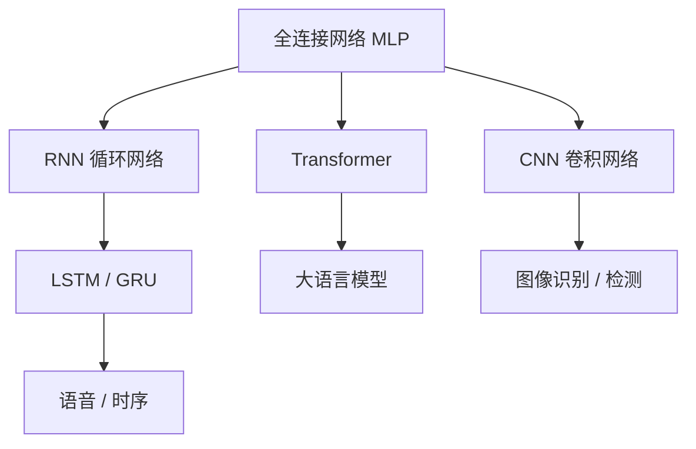

# 第 12 章：训练完之后

- **难度**：★★☆ | **预估学时**：0.8 小时 | **前置**：第 9、10、11 章

## 学习目标

学完本章，你能：

1. 说清 epoch、batch、学习率各自控制什么；
2. 判断一条训练曲线是不是过拟合；
3. 说出 CNN、RNN、Transformer 各自解决什么问题。

## 一句话核心

训练是把训练集上的损失压下去，泛化是让没见过的数据也表现好，这两件事不是一回事。

## 零基础讲解

### 训练的循环

第 11 章走了一遍"前向—反向—更新"。真实训练要把这个循环跑很多次。

**epoch**：把整个训练集完整看一遍叫一个 epoch。10 个 epoch 就是把所有样本过了 10 遍。

**batch**：一次更新用多少样本。取 1 个样本更新一次叫随机梯度下降（SGD）；取全部样本算完再更新叫批量梯度下降；取一小批（比如 32、64）叫 mini-batch，最常用。

**学习率**：每步走多大，第 10 章讲过。

为什么不用全部样本算梯度？因为全部算一遍太慢，而且全量梯度容易停在比较"平"的方向。小批量既有噪声带来的随机性，又能利用显卡并行，速度和质量折中得比较好。

### 过拟合：背答案

训练集损失一路下降，验证集损失先降后升，这是过拟合的典型形状。

模型在训练集上把细节甚至噪声都记住了，换一批数据就不行。就像学生把练习册答案背下来，考试换个数字就懵。

判断方法：切一份验证集（不参与训练），每个 epoch 结束后在验证集上算损失。如果训练损失还在降、验证损失开始升，就是过拟合开始了。

<svg viewBox="0 0 460 250" width="100%" role="img" aria-label="训练损失与验证损失的分离">
<line x1="50" y1="210" x2="430" y2="210" stroke="#9ca3af"/>
<line x1="50" y1="210" x2="50" y2="30" stroke="#9ca3af"/>
<path d="M 60 60 C 160 150, 300 185, 420 190" fill="none" stroke="#3b82f6" stroke-width="2"/>
<path d="M 60 60 C 140 140, 200 175, 250 150 C 300 125, 350 105, 420 85" fill="none" stroke="#dc2626" stroke-width="2" stroke-dasharray="5 4"/>
<text x="300" y="200" font-size="12" fill="#3b82f6">训练损失</text>
<text x="340" y="80" font-size="12" fill="#dc2626">验证损失</text>
<text x="200" y="235" font-size="12" fill="#6b7280">训练轮次 →</text>
</svg>

看图说明：蓝线持续下降，红线先降后升。两条线分开的位置就是过拟合开始的位置。实际训练会在红线最低点附近停下来，或者用正则化压住它继续上升的趋势。

### 常见的对抗手段

**正则化**：在损失里加一项惩罚大权重的项，比如 $\lambda\sum w_i^2$。权重被压小，模型输出对输入的细微变化不那么敏感。

**Dropout**：训练时随机把一部分神经元的输出置 0，逼网络不要依赖某几个特定神经元。推理时全部打开，按比例缩放。

**早停**：验证损失开始上升就停止训练，取验证损失最低的那个 checkpoint。

**数据增强**：图片翻转、裁剪、加噪声，让模型见不到"完全一样"的样本，逼它学更稳的特征。

这些手段都在做同一件事：限制模型"死记硬背"的能力，让它偏向更平滑、更通用的解。

### 网络家族地图

第 6 到 11 章讲的是**全连接网络**（也叫多层感知机 MLP）：每个神经元和上一层所有神经元相连。

它的问题：图片有 784 个像素，如果第一层 100 个神经元，就是 78400 个权重。参数多，而且丢掉了像素之间的空间关系。

**CNN（卷积神经网络）**：用卷积核在图上滑动，同一组权重扫过所有位置。参数共享大幅减少参数量，还保留了"邻近像素相关"的结构。适合图像。

**RNN（循环神经网络）**：按时间步处理序列，把上一步的隐藏状态传给下一步。适合文本、语音这类有顺序的数据。它的长距离依赖问题后来被 LSTM、GRU 缓解。

**Transformer**：用注意力机制让每个位置直接看到所有其他位置，不靠一步步传递。并行性好，长距离依赖强。现在的大语言模型基本都是这个结构。

它们的内核仍然是"线性变换 + 非线性激活 + 损失 + 反向传播"。变的只是"怎么组织连接"和"怎么算得更省"。

看图说明：所有分支都从 MLP 出发。CNN 改的是连接方式和参数共享，RNN 改的是时间维度的连接，Transformer 改的是信息交互方式。底层训练机制（损失、梯度、反向传播）没有变。

## 类比与实例

**类比**：过拟合像学生只背了练习册。题目数字一换就不会，因为记住的是答案不是方法。正则化像限制笔记篇幅，逼他提炼规律；数据增强像换不同版本的练习册，逼他适应变化。

类比失效的地方：学生背题是主动行为，模型的"记忆"是参数拟合的结果，没有意图。

**实例**：两个模型在同一份数据上训练。

模型 A：训练损失 0.01，验证损失 0.45。
模型 B：训练损失 0.08，验证损失 0.12。

A 在训练集上近乎完美，但验证集差得多，是过拟合。B 训练损失更高，验证损失更低，泛化更好。选 B。

## 常见误解

**别以为训练集准确率 100% 是好事**——这往往意味着模型把训练数据背下来了。真正要盯的是验证集指标。

**别以为 batch 越大越好**——大批量梯度更稳，但可能收敛到较差的解，且显存吃紧。小批量噪声大，有时反而帮助跳出局部低点。没有一律最优的 batch size。

**别以为 Transformer 取代了一切**——图像、时序、图结构上 CNN 和 RNN 变体仍然有优势。结构选择和任务、数据规模、算力都相关。

## 自测题（答案）

1. 训练损失持续下降，验证损失从第 5 个 epoch 开始上升，应该怎么处理？

   **答案**：在验证损失最低的位置早停，或加正则化、Dropout、数据增强，也可以减小模型规模。

   **解析**：验证损失上升说明模型开始记训练集的细节。早停是最直接的手段，正则化是让模型不那么容易记住。

2. mini-batch 和 SGD、批量梯度下降是什么关系？

   **答案**：SGD 是 batch size 为 1 的特例，批量梯度下降是 batch size 等于全部样本的特例，mini-batch 是两者之间的常用折中。

   **解析**：三者都是"用多少样本估计一次梯度"的不同选择。

## 复习锚点

- epoch = 过一遍数据；batch = 一次更新用多少样本；学习率 = 每步走多大。
- 过拟合的信号：训练损失降、验证损失升。
- 正则化、Dropout、早停、数据增强都是在限制"死记硬背"。
- CNN、RNN、Transformer 改的是连接结构，底层仍是前向 + 损失 + 反向传播。
